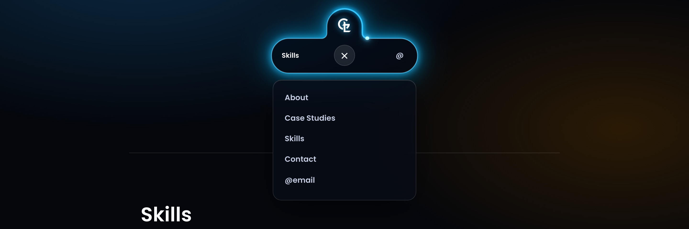

# Pill Nav: Glass Navigation with a Comet Border and Scroll Morph

A liquid-glass pill navigation bar with a glowing comet that travels its border. On scroll, the pill bobs like a boat on water, then morphs into a compact tab nav that names the section you're reading.

It's plain HTML, CSS and JavaScript with no framework, no build step and no dependencies.



---

## 🌐 Live Demo

**Try it now:** https://YOUR-USERNAME.github.io/pill-nav/

---

## ✨ Key Features

* **Comet border:** a glowing trail with a bright head travels the pill's real rounded border, hugging the curved ends instead of cutting across them. It's built from SVG strokes that are measured to the pill's rendered size.
* **Glass pill:** a frosted backdrop blur and blue neon glow brighten once the page scrolls.
* **Boat bob:** starting a scroll pulls the pill up, a slow swell rolls it while you scroll, and when you stop it dips and rocks back into place (spring-damper physics).
* **Morph to a tab nav:** past the hero, the full pill shrinks to the centre, sinks, and a logo tab rises out of it. The shape is redrawn from a single SVG path, glows and comet included.
* **Live section label:** the compact nav's left slot rolls to the current section's name.
* **Mobile menu:** below 860px, a glass dropdown opens from the hamburger button.
* **Accessible:**
  * The whole nav works by keyboard: Escape closes the menu and returns focus.
  * All tap targets are at least 44px.
  * There's a visible focus ring.
  * `aria-expanded` stays in sync with the menu.
  * With `prefers-reduced-motion`, the comet, bob and morph animation all switch off.

---

## 🚀 Getting Started

1. **Clone the repository:**
   ```bash
   git clone https://github.com/YOUR-USERNAME/pill-nav.git
   cd pill-nav
   ```
2. **Open `index.html`** in your browser. There's nothing to install.

### Using it on your own site

1. Copy `nav.css` and `nav.js` into your project.
2. Copy the `<nav class="nav has-morph" id="nav">…</nav>` block from `index.html`.
3. Give your page sections the ids the nav looks for (`about`, `work`, `skills`, `contact`), or edit the `SECTIONS` list near the top of the morph block in `nav.js`.
4. Swap in your own logo (the `--logo-mask` SVG in `nav.css`), name and email.

**Without the morph:** remove `has-morph` from the `<nav>`. You keep the glass pill, comet border and mobile menu.

`nav.css` only styles the nav. It doesn't reset or restyle the rest of your page. If you want the menu to work with JavaScript off, copy the `<noscript>` line from `index.html` too.

---

## 📂 Project Structure

* `index.html`: the demo page and nav markup.
* `nav.css`: all nav styles. The colour tokens are at the top under `:root`.
* `nav.js`: four small self-contained parts: the scrolled state and mobile toggle, the comet border tracer, the boat bob, and the tab morph.
* `LICENSE`: MIT.

---

## 🌍 Browser Support

Works in current Chrome, Edge, Safari and Firefox. The frosted glass uses `backdrop-filter` and falls back to a plain dark fill.

---

## 👨‍💻 Created By

**Garvin Lawrence**, UX designer and developer. See [garvinlawrence.com](https://garvinlawrence.com).

The tab morph comes from my own Figma design. The nav is live on my portfolio.
